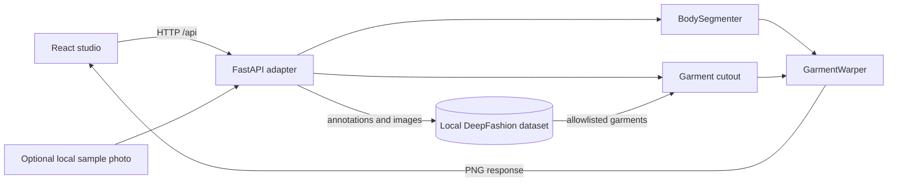

# TryBeforeUBuy

A local virtual styling studio for previewing a DeepFashion garment on a photo. The browser UI is a visual exploration tool, not a sizing or fit guarantee.

## Stack and requirements

- Python 3.10+ for the image-processing API
- Node.js 20.19+ (or 22.12+) and npm for the React/Vite frontend
- OpenCV and NumPy (installed from `requirements.txt`)
- The DeepFashion Category and Attribute Prediction Benchmark for the local garment catalog
- An optional sample photo at `downloads/sample-person.jpg`

If no sample photo is provided, the app uses an eligible person image from the local DeepFashion training set. Upload your own photo at any time.

## Install

From the repository root:

```bash
python3 -m venv .venv
source .venv/bin/activate
python -m pip install --upgrade pip
pip install -r requirements.txt

cd frontend
npm install
cd ..
```

## Local assets

Download the **Category and Attribute Prediction Benchmark** from the [official DeepFashion project page](http://mmlab.ie.cuhk.edu.hk/projects/DeepFashion.html). It is for non-commercial research purposes only. Extract the required files directly under the ignored `downloads/` directory:

```text
downloads/
├── list_landmarks.txt
├── list_bbox.txt
├── list_category_img.txt
├── list_category_cloth.txt
├── list_eval_partition.txt
├── img/                 # or img.zip
└── sample-person.jpg    # optional; overrides the dataset sample
```

Keep the image paths intact (`img/Category_Name/image.jpg`). To use a different dataset or sample photo, set `DEEPFASHION_DIR` and `SAMPLE_PERSON_PATH` before starting the API.

The optional OpenPose model files go in `models/pose/coco/` as `pose_deploy_linevec.prototxt` and `pose_iter_440000.caffemodel`. Without them, the segmenter estimates torso keypoints from the detected body mask.

## Run locally

Open two terminals from the repository root. Start the API in the first:

```bash
source .venv/bin/activate
uvicorn api.app:app --reload
```

Start the browser app in the second:

```bash
cd frontend
npm run dev
```

Open [http://127.0.0.1:5173](http://127.0.0.1:5173). The Vite development server proxies `/api` requests to `http://127.0.0.1:8000`.
Use **Help** in the studio header for the in-app walkthrough, photo tips, and preview limitations.

The API starts even when local assets are missing. Check readiness at [http://127.0.0.1:8000/api/health](http://127.0.0.1:8000/api/health). The response distinguishes dataset/catalog readiness from sample-photo availability; without a dataset, the wardrobe and live try-on are unavailable rather than replaced with fake results.

## Use the studio

1. Select one garment from the catalog or filter by its category.
2. Use the sample photo if installed, or upload a front-facing JPEG/PNG (up to 10 MB).
3. Choose **Try it on**. The Python service segments the person, cuts out and warps the garment, then returns a PNG.
4. Switch between **Before** and **After**, then download the preview.
5. To preview another combination, choose a garment or photo again and generate a new result.

Clear lighting and an unobstructed upper body improve the chance of a usable preview. Garments must have visible DeepFashion landmarks; the catalog is bounded to a curated subset of compatible training images. The default browser request timeout is 60 seconds. Timing out does not cancel server-side processing.

## API

| Endpoint | Behavior |
| --- | --- |
| `GET /api/health` | Reports service, dataset, catalog, and sample-photo readiness |
| `GET /api/garments?category=...` | Returns available garments and category filters |
| `GET /api/garments/{id}/image` | Serves a catalog image (IDs are allowlisted from the local catalog) |
| `GET /api/sample-person` | Serves the configured sample image when present |
| `POST /api/try-on` | Accepts multipart `person` and `garment_id`; returns a PNG |

Errors use `{ "error": { "code": "...", "message": "..." } }`. Uploaded images are decoded and processed in memory; the app does not intentionally save them.

## Troubleshooting

- **The wardrobe says it is waiting:** confirm the five annotation files and either `img/` or `img.zip` are directly under `downloads/`. Check `/api/health` for readiness.
- **The sample photo is unavailable:** the default sample is chosen from the local training set when possible. Otherwise add a JPEG/PNG at `downloads/sample-person.jpg`. If `SAMPLE_PERSON_PATH` is set, make sure it points to a valid image.
- **A try-on is rejected:** use a front-facing photo with a clear upper body and shoulders. The current pipeline needs visible garment landmarks and may not align every photo.
- **The browser cannot reach the API:** activate the Python environment, start Uvicorn on port 8000, and keep the Vite development server running on port 5173.
- **The request takes too long:** the browser reports a retry message after 60 seconds; this does not cancel work already running in the API.

## Verify

```bash
source .venv/bin/activate
python -m pytest -q

cd frontend
npm run build
```

The API tests use a small generated fixture and mocked processing components to verify the HTTP contract; they do not prove try-on quality on the full DeepFashion dataset. End-to-end visual processing requires the local dataset and a suitable person photo.

## Architecture


